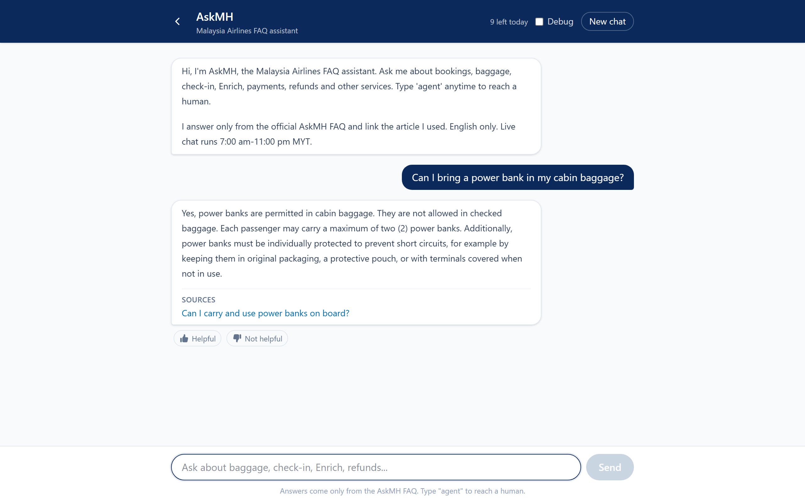
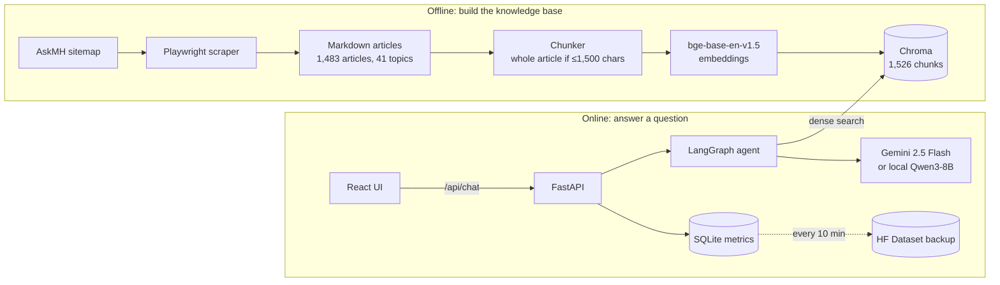
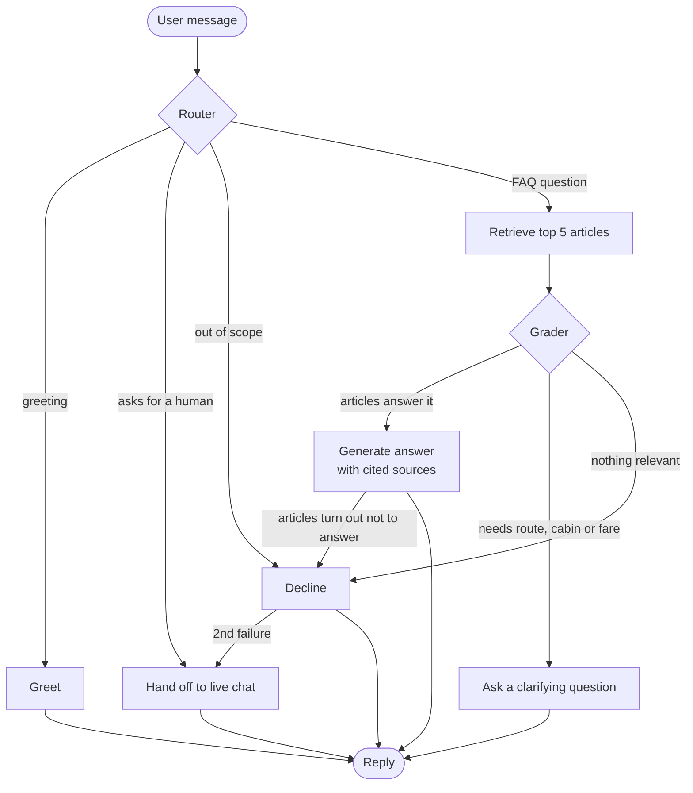

# AskMH Chatbot

A RAG chatbot that answers Malaysia Airlines passenger questions using only the official [AskMH help centre](https://www.askmh.malaysiaairlines.com/faq/s/). Every answer links to the article it came from. When a question depends on details the user hasn't given, such as route, cabin or fare, it asks a follow-up question. When it can't answer, it hands off to (simulated) live chat instead of guessing.

**Live demo:** https://askmh-194250607947.asia-southeast1.run.app (Google sign-in required, because the demo shares a free-tier model quota)



Non-commercial portfolio project, not affiliated with Malaysia Airlines. The FAQ content belongs to Malaysia Airlines.

## Architecture



### Agent flow

Each user message runs through a LangGraph state machine. A FAQ question takes three LLM calls: router, grader and generator.



- **Router** classifies the message and rewrites it as a standalone question, using the conversation so far. The rewrite becomes the search query.
- **Retrieve** runs a dense search in Chroma, over-fetches chunks and keeps the top 5 distinct articles.
- **Grader** decides whether those articles answer the question, need a clarifying question, or are irrelevant.
- **Generate** answers only from the graded articles and cites their URLs. If they don't actually answer the question, it refuses, and that counts as a failure.
- **Handoff** triggers when the user asks for a human or after 2 failures. Live chat hours are 7:00 am to 11:00 pm MYT.

### Components

| Layer | Tech | Folder |
|---|---|---|
| Ingestion | Playwright (the site is a JS-rendered Salesforce portal), BeautifulSoup, markdownify | `ingest/` |
| Indexing | Hugging Face `BAAI/bge-base-en-v1.5`, Chroma (cosine) | `index/` |
| Agent | LangChain, LangGraph, Gemini 2.5 Flash or Ollama `qwen3:8b` | `agent/` |
| Backend | FastAPI, Google sign-in, per-user and global quotas | `api/` |
| Frontend | React 19, TypeScript, Vite, Tailwind v4 | `web/` |
| Metrics | SQLite (outcomes, feedback, source clicks), mirrored to a private HF Dataset | `app/` |
| Evaluation | pytest layers, 50-question QA set, LLM benchmark | `tests/`, `eval/` |
| Hosting | One Docker container on Google Cloud Run, scales to zero | `Dockerfile`, `deploy/` |

### Design choices

- **Dense retrieval only.** Hybrid dense + BM25 scored lower than plain dense on the 50-question eval, so the agent dropped it ([FINDINGS.md](eval/FINDINGS.md) F1).
- **Small articles stay whole.** 98% of articles are under 1,500 characters, so they are embedded as one chunk. Longer ones split at paragraph breaks, and tables are never split.
- **Gemini thinking off.** It gave the same accuracy as dynamic thinking, at about half the median latency and a fifth of the cost ([benchmark report](eval/benchmarks/2026-10-16-gemini-thinking/REPORT.md)).
- **Sign-in protects the quota, not the key.** The Gemini key never leaves the server. Google sign-in only gates who can spend the shared daily quota.
- **No stored conversations.** Chat memory is in-memory and deleted when the user refreshes, closes the tab or starts a new chat. Only anonymous metrics persist.
- **Source links go through `/go`.** It logs the click for click-through metrics and only redirects to AskMH URLs.

## Results

**Retrieval** (50 paraphrased questions, worded differently from the article titles): Recall@5 **96%** (48/50), MRR **0.848**.

**End-to-end** (50 questions, full agent, recorded 2026-10-16):

| Model | Answered, correct source cited | Asked a clarifying question | Declined | Handed off | Median turn |
|---|---|---|---|---|---|
| Gemini 2.5 Flash, thinking off | 36 | 7 | 6 | 1 | 3.9 s |
| Qwen3-8B, local RTX 4060 | 22 | 16 | 12 | 0 | 2.4-3.2 s |

A clarifying question is a valid outcome, not a failure: many AskMH answers depend on the route, cabin or fare. Counting both, Gemini handles **43/50 (86%)** and Qwen 38/50 (76%) without declining. Every answer either model gave cited the correct article.

**Tests:** 40 pass on local Qwen3-8B, across 7 layers tested bottom-up: retrieval, structured output, router, grader, generation, full graph and API sessions.

Write-ups: [eval/FINDINGS.md](eval/FINDINGS.md) covers the defects the test suite found and how they were fixed. The [benchmark report](eval/benchmarks/2026-10-16-gemini-thinking/REPORT.md) compares Gemini thinking modes with Qwen and covers a router bug triggered by curly apostrophes.

## Project structure

```
config.py     settings, read from .env
ingest/       sitemap, Playwright scraper, HTML to Markdown
index/        chunker, embeddings, index builder, search CLI
agent/        retriever, LangGraph nodes and graph, prompts, terminal chat
api/          FastAPI app, auth, quotas, schemas
app/          SQLite metrics and HF Dataset sync
web/          React frontend
tests/        layered test suite
eval/         QA set, harness, findings, benchmarks
deploy/       Cloud Run walkthrough
```

`data/` (scraped articles and the Chroma index) is gitignored, so you build it locally with steps 1 and 2 below.

## Run it locally

### Setup

```powershell
conda create -n askmh python=3.11 -y
conda activate askmh
pip install torch --index-url https://download.pytorch.org/whl/cu128
pip install -r requirements.txt
python -m playwright install chromium
copy .env.example .env
```

Every Python command below assumes `conda activate askmh` and the repo root as the working directory.

Ollama must be running with `qwen3:8b` pulled (`ollama pull qwen3:8b`). To use Gemini instead, set `CHAT_PROVIDER=gemini` and `GOOGLE_API_KEY` in `.env`.

### 1. Scrape AskMH

```powershell
python -m ingest.scraper            # incremental: only new/changed articles (by sitemap lastmod)
python -m ingest.scraper --limit 5  # quick test
python -m ingest.scraper --force    # re-scrape everything
```

Output: `data/articles/<topic>/<article-slug>.md`, one file per article with YAML frontmatter (`title`, `url`, `topic`, `last_updated`, ...). Tables with merged cells are expanded into full Markdown grids. A few sitemap entries redirect to a login page and are skipped as `LoginRequired` in `data/failed.json`.

### 2. Build the index

```powershell
python -m index.build_index                          # ~2 min on GPU
python -m index.search "power bank" --mode dense     # dense | bm25 | hybrid
```

### 3. Chat in the terminal

```powershell
python -m agent.chat --debug
```

### 4. Run the app

Terminal 1, the API (wait for `Application startup complete`):

```powershell
python -m uvicorn api.main:app --port 8001           # Swagger at http://127.0.0.1:8001/docs
```

Terminal 2, the React frontend (see [web/README.md](web/README.md)):

```powershell
cd web
npm install
npm run dev                                          # http://localhost:5173
```

API routes live under `/api` (`/api/health`, `/api/greeting`, `/api/chat`, `/api/feedback`, `/api/config`). `/go` stays at the root because source links open in a new tab without an auth header. If `web/dist` exists, the API also serves the built frontend at `/`, which is how the container runs everything on one port:

```powershell
cd web; npm run build; cd ..
python -m uvicorn api.main:app --port 8001          # now serves the UI at / too
```

### Sign-in (optional locally, required for the hosted demo)

Off by default, so nothing above needs credentials. To try it, set in `.env`:

```
AUTH_ENABLED=true
GOOGLE_OAUTH_CLIENT_ID=<your web client id>.apps.googleusercontent.com
SESSION_SECRET=<python -c "import secrets; print(secrets.token_urlsafe(32))">
```

The API refuses to start if sign-in is on and `SESSION_SECRET` is missing, too short or left at the default, since a weak secret lets anyone forge a session. Per-user and global daily caps (`DAILY_MESSAGES_PER_USER`, `DAILY_MESSAGES_GLOBAL`) protect the shared quota and return 429 when hit.

### 5. Tests

```powershell
python -m eval.run_suite                             # all layers
python -m pytest tests/test_3_router.py -v           # one layer
```

### Deploy

See [deploy/DEPLOY.md](deploy/DEPLOY.md) for the Cloud Run walkthrough.
